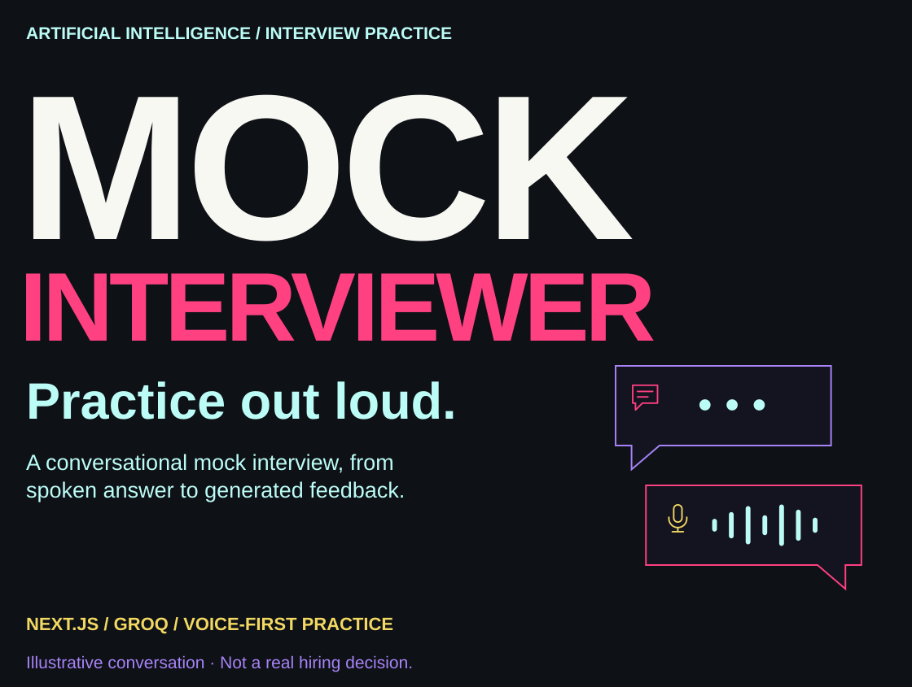
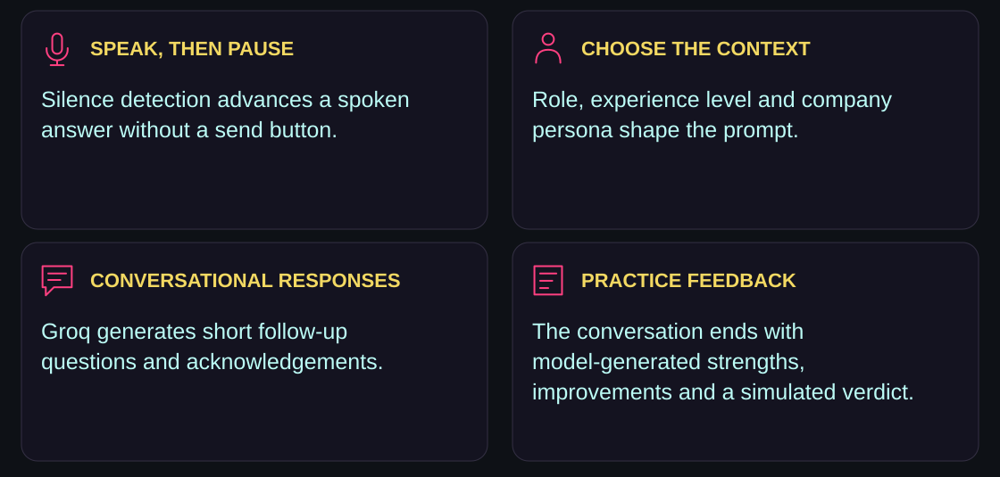
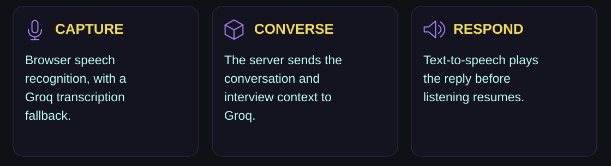
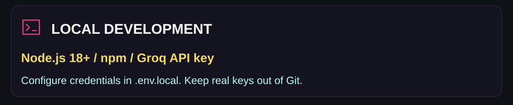
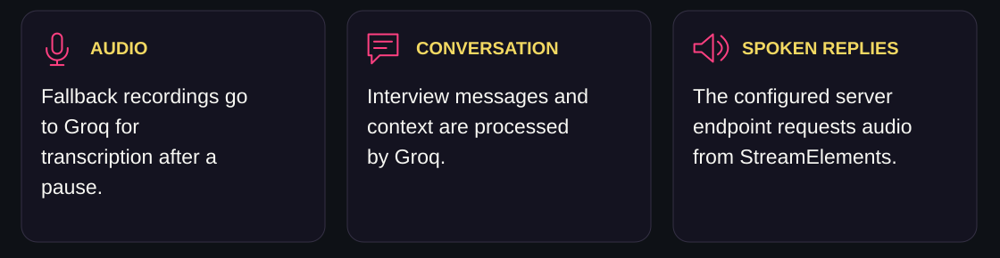
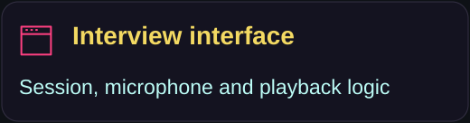
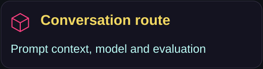
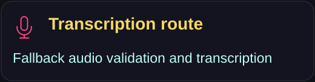
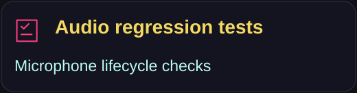
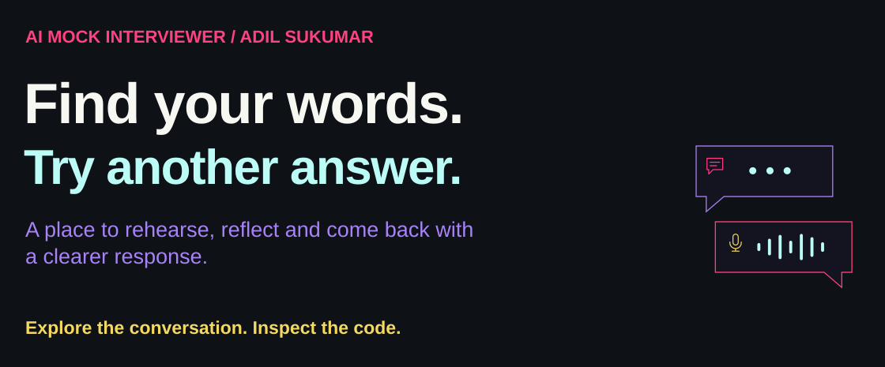

<p><picture><source media="(max-width: 600px)" srcset="assets/readme/hero-mobile.svg"/></picture></p>

<p align="center"><a href="#the-practice-session">Practice session</a> · <a href="#how-the-conversation-flows">Speech flow</a> · <a href="#run-locally">Run locally</a> · <a href="#permissions-and-data-flow">Permissions & data</a> · <a href="#explore-the-code">Explore</a></p>

A voice-first mock interview project for rehearsing spoken answers, receiving follow-up questions and reviewing generated feedback. Choose a role, experience level and company persona, then practice a short conversation with a Groq-hosted language model.

**This is a practice simulation. Its “Hired” / “Not Hired” output is model-generated feedback, not an employment decision or a validated assessment of interview readiness.**

<a id="the-practice-session"></a>

##  The practice session

<p><picture><source media="(max-width: 600px)" srcset="assets/readme/features-mobile.svg"/></picture></p>

The prompt asks the interviewer to keep replies concise and aim for roughly four to five questions before returning an interview-complete marker. Completion is prompt-guided; it is not a guaranteed five-question counter. Company personas are generated prompt contexts, not official company interview materials.

<a id="how-the-conversation-flows"></a>

##  How the conversation flows

<p><picture><source media="(max-width: 600px)" srcset="assets/readme/pipeline-mobile.svg"/></picture></p>

| Component | Current implementation |
| --- | --- |
| Interface | Next.js 14 App Router, React 18, TypeScript, CSS and Lucide icons. |
| Conversation | Groq chat route; `GROQ_MODEL` defaults to `openai/gpt-oss-20b`. Availability depends on the configured account. |
| Transcription | Browser `SpeechRecognition`, with MediaRecorder/Web Audio and Groq transcription as a fallback. |
| Spoken replies | Server request to StreamElements with the `Joanna` voice; browser speech synthesis is a playback fallback. |
| Webcam | Preview in the current interview screen; automated vision monitoring is not enabled. |
| Session restriction | A visibility change can end the mock session. This does not establish that cheating occurred. |

A working Groq API key and network access are required. Availability and quotas depend on the configured providers.

<a id="run-locally"></a>

##  Run locally

<p><picture><source media="(max-width: 600px)" srcset="assets/readme/environment-mobile.svg"/></picture></p>

Clone the actual repository and install dependencies:

```bash
git clone https://github.com/adilsukumar/AI-Mock-Interviewer.git
cd AI-Mock-Interviewer
npm install
```

Create `.env.local` at the project root using placeholder values as a guide:

```env
GROQ_API_KEY=your_groq_api_key_here
GROQ_MODEL=openai/gpt-oss-20b
GROQ_STT_MODEL=whisper-large-v3-turbo
```

Start the development server:

```bash
npm run dev
```

Open [http://localhost:3000](http://localhost:3000). Choose the session context and grant permissions when requested. Keep the interview tab visible during the mock session.

Run the existing microphone lifecycle regression checks:

```bash
npm test
```

<a id="permissions-and-data-flow"></a>

##  Permissions and data flow

<p><picture><source media="(max-width: 600px)" srcset="assets/readme/privacy-mobile.svg"/></picture></p>

To use the application, you must grant the browser permission to access your **Microphone**. A webcam preview is also provided to simulate a professional environment.

Use a current browser on HTTPS (or localhost). Microphone permission and speech recognition are checked separately. Browsers without speech recognition, or with a failing speech service (such as Brave), automatically use microphone recording and Groq Whisper transcription. The interview remains hands-free: speak, then pause for approximately 2.5 seconds. Fallback audio is sent to Groq after the pause, and answers are limited to two minutes and 4 MB. The fallback requires MediaRecorder and Web Audio support. Listening pauses while the interviewer speaks or processes an answer. **Retry microphone** recovers capture or transcription errors. An unanswered permission prompt becomes retryable after 15 seconds.

Run microphone lifecycle regression checks with `npm test`.

The interview screen shows a webcam preview. Its separate experimental vision endpoint is currently inactive in that session flow.

<a id="explore-the-code"></a>

##  Explore the code

<p align="center"><a href="src/app/interview/page.tsx"></a> <a href="src/app/api/chat/route.ts"></a> <a href="src/app/api/transcribe/route.ts"></a> <a href="tests/audio-recording.test.cjs"></a></p>

<details>
<summary><strong>Session behavior at a glance</strong></summary>

- Keep the interview tab visible; visibility changes can terminate the session.
- Speech capture pauses while a response is generated or spoken.
- The fallback captures an answer after a pause and applies duration and size limits.
- Use **Retry microphone** to recover a capture or transcription error.
- Generated interview feedback is intended for personal practice.

</details>

<p><picture><source media="(max-width: 600px)" srcset="assets/readme/closing-mobile.svg"/></picture></p>

<p align="center"><a href="https://github.com/adilsukumar/AI-Mock-Interviewer/issues">Discuss an improvement</a> · <a href="src/app/api/chat/route.ts">Read the prompts</a> · <a href="https://www.adilsukumar.xyz/">Meet the builder</a></p>
